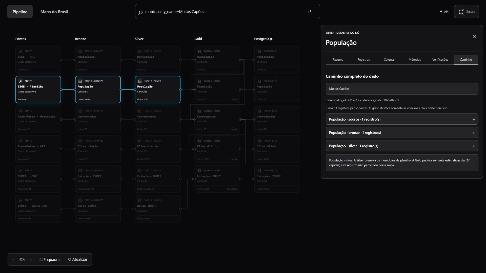
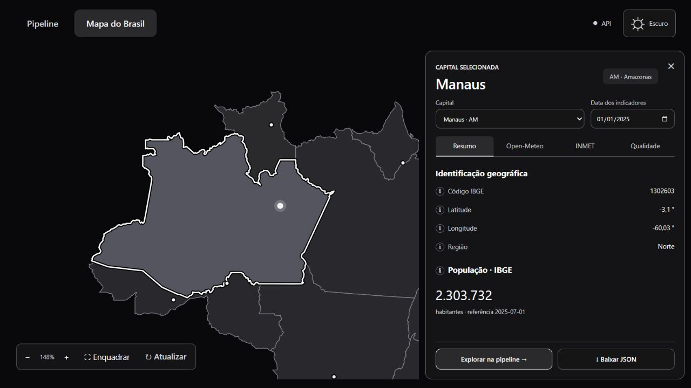
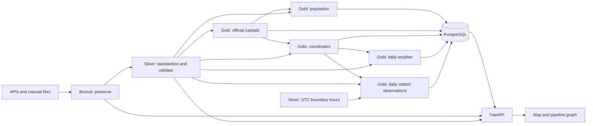

# Viajando com o Dado

**From public sources to an application: data engineering with visual provenance.**

[Versão em português](README.md) · [Input data guide](data/README.md)

This portfolio project explores demographic and weather information for Brazil’s 27 state capitals, including Brasília. It makes collection, preservation, standardization, joins, aggregation and database publication visible for individual records—including records that stop before Gold.

The stack combines PySpark, Parquet, PostgreSQL, FastAPI, DuckDB and a lightweight HTML/CSS/JavaScript interface. It follows an **ETL** flow: transform data in files first, then load the curated outputs into PostgreSQL. The runner calls Python functions directly; it does not execute notebooks.



## Features

- Interactive map with population, coordinates, weather indicators, coverage and quality information.
- A five-column graph: Sources → Bronze → Silver → Gold → PostgreSQL, with actual cross-source dependencies.
- Node-level records, schemas, method descriptions, checks and aggregation explanations. Source code is not sent to the frontend.
- Global search by municipality, station or field value, including municipalities absent from Gold.
- Complete record journeys with real connections highlighted, join inputs included, and explanations when a record stops.



On the map, population uses the latest published reference date for each capital. The date selector controls weather indicators only; earlier population reference dates remain available through the API.

## Data and sources

The default weather period is **2025**. Population estimates have their own reference date; they are neither daily observations nor a 2025 census.

| Source | Acquisition | Use |
| --- | --- | --- |
| [IBGE Localities API](https://servicodados.ibge.gov.br/api/docs/localidades) | API; the collector saves the 27 official capitals by IBGE ID | Municipality, state and regional reference |
| [IBGE population estimates](https://www.ibge.gov.br/estatisticas/sociais/populacao/9103-estimativas-de-populacao.html) | Manually downloaded `.xls` workbook | Municipality estimates, reference date and notes; Silver preserves all municipalities in the workbook |
| [Open-Meteo Geocoding](https://open-meteo.com/en/docs/geocoding-api) | City/state lookup API | Coordinates used by weather requests |
| [Open-Meteo Historical Weather](https://open-meteo.com/en/docs/historical-weather-api) | API with `models=era5` and `timezone=auto` | Daily mean/minimum/maximum temperature, precipitation and maximum wind speed |
| [INMET historical data](https://portal.inmet.gov.br/dadoshistoricos) | Manually obtained automatic-station CSV files | Hourly station observations and metadata, aggregated into local-calendar days |

**ERA5 reanalysis and INMET station observations are different kinds of data.** Their values need not agree; the application keeps the sources separate.

The development workbook is `POP2025_20260828.xls`, with population reference date **2025-07-01**. The filename also identifies a later file revision; it does not make the population reference year 2026. In that version, **Muitos Capões/RS has an estimate of 2,937 residents**.

Each daily Gold weather table has a 27 × 365 calendar: **9,855 rows for 2025**. A row does not imply a valid measurement: missing data and unavailable station assignments remain explicit. The map uses **IBGE Geographic Meshes API v3**. On **2026-11-04**, the JSON content bundled in `frontend/assets/brazil-states.geojson` was verified to match the response from this [official endpoint](https://servicodados.ibge.gov.br/api/v3/malhas/paises/BR?intrarregiao=UF&formato=application%2Fvnd.geo%2Bjson&qualidade=minima) exactly: 27 features covering the 26 states and the Federal District.

Parameters: `intrarregiao=UF`, `formato=application/vnd.geo+json`, `qualidade=minima`. No `periodo` is pinned, so the API provides its current version. The comparison ignores whitespace and formatting. See the [official mesh documentation](https://servicodados.ibge.gov.br/api/docs/malhas?versao=3).

The geometry is bundled with the frontend and rendered as SVG; opening the app does not request it from IBGE again. Capital points and indicators come from Gold. State outlines are visual context and do not participate in quality calculations or station assignments.

### Reading map indicators

The date selector chooses the **weather day in the capital's local timezone**. Population has an independent reference date: viewing weather for **2025-01-01** alongside the estimate for **2025-07-01** does not make that estimate a January population count. The application does not interpolate daily population.

| Aspect | Open-Meteo in this project | INMET in this project |
| --- | --- | --- |
| Nature | ERA5 reanalysis for a grid cell near the requested coordinates | Observations from an automatic station assigned to the capital |
| Input resolution | Already aggregated daily indicators | Hourly observations aggregated by the project into local-calendar days |
| Displayed quality | Record presence, availability of five variables, missing/invalid fields and warnings | Station assignment, valid hours and coverage for each indicator |
| Completeness | Five daily variables available under the project's rules | Hourly coverage evaluated against each indicator's requirement |
| Gusts | Not requested in this collection | Published when coverage is sufficient |

**“5 of 5 indicators” does not mean “24 of 24 hours”.** The daily Open-Meteo response does not establish 100% hourly coverage. Available values without warnings do not establish absolute accuracy or representativeness of every neighbourhood. Differences between sources may reflect the reanalysis grid, station location/elevation and aggregation methods. State outlines provide geographic context; the indicators concern the selected capital and source, not the whole state.

### Worked value checks

In the files checked for the demonstration, São Paulo has IBGE ID **3550308** and an estimated **11,904,961 residents**, referenced to **2025-07-01**. This matches the [official IBGE 2025 estimates](https://ftp.ibge.gov.br/Estimativas_de_Populacao/Estimativas_2025/POP2025_20251031.pdf).

| Source and São Paulo date | Mean | Minimum | Maximum | Rain | Maximum wind | Maximum gust |
| --- | --- | --- | --- | --- | --- | --- |
| Open-Meteo · 2025-01-01 | 22.7 °C | 17.8 °C | 28.1 °C | 7.4 mm | 3.58 m/s | Not collected |
| INMET · 2025-01-17 | 24.05 °C | 20.4 °C | 28.3 °C | 1 mm | 3.8 m/s | 8.5 m/s |

These are independent checks on **different dates**, not a same-day source comparison. The first JSON contains **12.9 km/h** wind: dividing by **3.6** gives **3.5833… m/s**, displayed as 3.58 m/s. The second mean recalculated from the CSV is **24.054166… °C**. Station **A701 · São Paulo – Mirante** is approximately **5.92 km** from the capital coordinates used by the project; each indicator on that day has 24 valid hours.

These examples document the files checked, not future collections or publications. To reproduce them, select the same capital/date/source, inspect units and quality, and follow the recorded origins. INMET recalculation must distinguish message instants from completed hourly intervals as explained below.

## Architecture and transformations



| Layer | Responsibilities |
| --- | --- |
| Collection | Fetch IBGE, geocoding and weather data; write JSON by state. Failed geocoding/weather collection preserves the previous pair for that state |
| Bronze | Preserve source structure, values and origins; keep workbook sheet/row/cells and INMET header/metadata/original lines |
| Silver | Normalize types, names, IDs, coordinates, dates and units; consolidate equivalent duplicates; reject conflicts; distinguish missing, invalid and flagged values |
| Gold | Validate official capitals, join sources, complete calendars and calculate daily indicators with explicit coverage requirements |
| Load | Validate keys/contracts and publish all five business tables plus lineage links in one transaction; upsert by key and preserve other published periods |

Parquet writes use temporary output and validation before replacement. Interrupted-write recovery is retained; it is not an audit-history mechanism.

### INMET rules and units

Silver preserves precipitation, atmospheric pressure, global radiation, air and dew-point temperatures, relative humidity, wind direction/speed/gusts and available hourly extremes. Source markers such as `-9999` become missing values. Unparseable numbers and physical inconsistencies are identified separately.

Gold selects a fixed station per capital and period. It must be in the same state, within **50 km**, and have at least **90% temperature and precipitation coverage** over the period. The nearest eligible station wins, followed by coverage and station code as tie-breakers.

| Daily metric | Operation | Minimum hourly coverage |
| --- | --- | --- |
| Mean temperature | Mean of valid instantaneous temperatures | 90% |
| Minimum/maximum temperature | Extreme of hourly interval observations | 100% |
| Precipitation | Sum of hourly accumulations | 100% |
| Maximum wind speed | Maximum instantaneous speed | 100% |
| Maximum gust | Maximum interval gust | 100% |

UTC timestamps are assigned to the capital's local-calendar day. Instantaneous observations use the message instant; accumulated values and interval extremes use the hour that ended. Compatible next-year boundary hours complete the final local day: same station/state and at most 100 m metadata-coordinate difference.

No eligible station does **not** mean that a state has no stations. It means the available stations failed the project’s assignment criteria for that capital. Missing measurements are not invented.

Temperature uses °C, precipitation mm and wind m/s. Open-Meteo wind speed is converted from km/h in Silver. Gusts in this application come from INMET; they are not requested from Open-Meteo.

### Where checks take place

For Open-Meteo, **Silver** validates input units, expands daily arrays, interprets values and converts wind from km/h to m/s. **Gold** receives standardized values, checks identity and quality consistency, rejects duplicate dates, joins the capital reference and completes the calendar. Only the invalid variable is nulled; interpretable values and provenance remain in Silver.

The **Checks** tab describes manually catalogued rules; it is not a per-record execution certificate. Execution status appears in Summary, while data-quality fields describe the record. The current catalogue shares the Open-Meteo list between Silver and Gold: “Recognized units before conversion” can therefore appear under Gold even though Silver performs that operation. This documents the difference between the displayed description and implementation; it does not change the interface.

## Current-publication provenance

The project tracks **one current execution**. It does not retain snapshots, historical code versions or immutable before/after audit history.

- `pipeline/shared/catalog.py` manually describes nodes, methods, checks and dependencies; keep it aligned with transformation changes.
- `data/pipeline_status.json` holds current step status, timing, counts and errors.
- `pipeline_trace.current` identifies the publication and destination schema.
- `pipeline_trace.links` stores keys and join/aggregation relationships, not copies of business values.
- Gold INMET writes selected-hour keys to `data/lineage/inmet_2025`; Load publishes those links.
- The backend resolves simple relationships from preserved keys/origins, follows the selected record’s outputs, then includes all their upstream inputs. It does not expand unrelated outputs of joined dimensions.

The graph highlights actual participating nodes and edges. Stage examples are limited for readability; counts and graph membership include the complete computed journey. Full current-layer rows remain available through Records.

Journey queries require a matching successful publication. File name, size and modification-time checks detect ordinary replacements; they are not cryptographic tamper proof. New publications also check original source files. Journeys larger than 40,000 records request a narrower filter instead of silently presenting a truncated result as complete.

### Reading graph counts and titles

Node cards show the **total dataset size at that stage**; Journey counts only **participating nodes and records in the selected path**. “13 nodes · 13 participating records” can coexist with a card showing 9,855 rows. Dimmed nodes are outside that path and do not necessarily indicate failed processing or missing data.

- **27 Open-Meteo Bronze rows → 9,855 Silver rows:** each Bronze row preserves one capital's annual response; Silver expands its 365 dates. This increase does not itself indicate duplicate records.
- **Population Bronze → Silver → Gold:** Bronze preserves spreadsheet rows, Silver extracts municipalities, and Gold selects capitals. Row-count reductions must be interpreted according to these operations.
- **“INMET stations” in Gold/PostgreSQL:** despite the title, each published row represents a **capital and a day**, with the selected station, aggregated indicators and coverage; it is not one row per station.
- **Source → Bronze:** the source preview uses the raw Bronze reading. Identical preview content does not represent another independent observation; provenance still identifies the original file.

A journey establishes the records and dependencies associated with an output. It does not itself prove source accuracy or successful execution of every described check for that record.

## Run with Docker Compose

### Prerequisites

- Docker running Linux containers and Compose supporting `service_completed_successfully`.
- Manual source files prepared as described in [data/README.md](data/README.md).
- About **8 GB RAM available to Docker**, disk space for images/data and internet access for builds/API collection. Spark uses two local cores and a 4 GB driver.

From the project root, create `.env` only if it does not already exist, then set a local `PGPASSWORD`:

```powershell
if (-not (Test-Path .env)) { Copy-Item .env.example .env }
# Edit .env and preserve any existing configuration.
docker compose up --build -d
```

On Linux/macOS, use `cp .env.example .env` for the initial copy.

Open **http://127.0.0.1:8080**. API documentation: **http://127.0.0.1:8080/api/docs**. The initial image build and data processing can take several minutes; application services become available after a successful pipeline run.

The isolated Compose project `viajando-com-o-dado-capitais` starts:

1. **postgres:** persistent named volume and readiness healthcheck.
2. **pipeline:** creates the database, processes the layers and loads PostgreSQL for the initial publication. When a publication already exists, exits without reprocessing data.
3. **backend:** waits for successful pipeline completion and mounts `data` read-only.
4. **frontend:** Nginx serves the interface and proxies `/api` to the backend using the same browser origin. The proxy follows backend IP changes through the internal Docker DNS, with a five-second revalidation interval.

Only the frontend exposes a host port, bound to `127.0.0.1`. Existing databases are not automatically erased.

| Variable | Purpose |
| --- | --- |
| `PGUSER`, `PGPASSWORD`, `PGDATABASE` | Database credentials and application database |
| `PIPELINE_YEAR` | Weather year; defaults to 2025 |
| `PIPELINE_START_AT` | `consume` for APIs or `bronze` to reuse collected JSON |
| `VCD_GOLD_SCHEMA` | Business-table schema; defaults to `gold` |
| `FRONTEND_PORT` | Local frontend port; defaults to 8080 |

Compose sets `PGHOST=postgres` and `PGPORT=5432` internally, regardless of the local-development hostname.

```powershell
docker compose ps -a
docker compose logs -f pipeline
docker compose logs backend frontend
docker compose run --rm pipeline python -m pipeline.run_pipeline --year 2025 --start-at consume --stop-after load
```

The last command explicitly reruns the pipeline while existing application services remain running. To reuse collected JSON files, replace `--start-at consume` with `--start-at bronze`. Add `--schema YOUR_SCHEMA` if using a custom `VCD_GOLD_SCHEMA`.

### Restarting versus reprocessing

**The pipeline runs automatically only for the initial publication.** Once a publication exists, `docker compose up -d`, or `docker compose down` followed by `docker compose up -d`, starts the application using existing data. It does not collect or transform data again. Changes to source files, code or the configured year do not trigger automatic reprocessing. Reprocessing requires the explicit command above. `docker compose run --rm pipeline` alone also reuses an existing publication.

To restart only the application:

```powershell
docker compose restart backend frontend
```

Deleting collected JSONs or local layer outputs does not remove the database, and restarting the site does not recreate those files. Use the explicit manual command with `--start-at consume` to restore the local data required for record journeys.

Failed or interrupted runs are never silently marked successful or automatically retried. Previously published database records remain available, but inconsistent record journeys stay blocked until a successful manual run. If the initial run fails before publication, fix the cause and use the manual command above. Journey queries wait for a consistent new publication. `docker compose down` preserves the database volume; avoid `down -v` if you want to keep that database.

Changing `.env` does not reset credentials inside an existing PostgreSQL volume. Keep the original password or change it administratively before updating the configuration.

## Run without Docker

Install **Python 3.12+**, Java 17+ and PostgreSQL. Java is needed by the pipeline; the backend does not start Spark.

```powershell
python -m venv venv
.\venv\Scripts\Activate.ps1
python -m pip install -r requirements.txt
python -m pipeline.run_pipeline --year 2025
```

Reuse collected data with:

```powershell
python -m pipeline.run_pipeline --year 2025 --start-at bronze --stop-after load
```

Run these in separate terminals:

```powershell
python -m uvicorn backend.main:app --host 127.0.0.1 --port 8000
python -m http.server 5173 --bind 127.0.0.1 --directory frontend
```

Open http://127.0.0.1:5173; API docs are at http://127.0.0.1:8000/docs. Activate the environment with `source venv/bin/activate` on Linux/macOS.

Windows Spark uses the filesystem adapter under `pipeline/bronze/lib`; the Linux image does not need it. Layer notebooks remain available for learning and individual execution.

Use one pipeline per data directory and connect the backend to the database published by that execution. Do not combine the local database with Compose execution state. `--year` does not download manual inputs for another year.

## Search examples

Search is global and does not require selecting a node. If several rows match, choose the record to trace. For each dataset, results prefer the furthest matching layer to avoid showing the same row repeatedly at every stage.

| Query | Explore |
| --- | --- |
| `municipality_name=Muitos Capões` | Workbook → Bronze → Silver, with an explanation for stopping before Gold |
| `population=2937` | Exact numeric match for the estimate in the development workbook |
| `Porto Velho` | Capital records across datasets |
| `station_code=A925` | Station records, depending on available coverage |
| `humidity_pct=41` | Silver INMET humidity; does not match 41.5 or 141 |
| `recfe` | Approximate name matching for Recife |
| `municipality_name=Vitória` | Municipality-name matching with accent normalization |
| `Recife;17/03/2025` | Capital weather on this date |
| `Manaus; data=2025-12-31` | Choose INMET to inspect next-year UTC boundary hours |

Separate filters with **semicolons (`;`)**: `Recife;17/03/2025` or `municipality_name=São Paulo;date=2025-03-17`. Spaces belong to multiword names and do not separate filters.

Aliases: `population` means `population_estimate`; `humidity_pct` means `relative_humidity_percent`; `municipality_name` searches municipality names. Dates accept `YYYY-MM-DD` or `DD/MM/YYYY`. IBGE IDs are not silently corrected. One measurement-column filter can be combined with municipality/date filters.

`month=2025-02-01` and `split=train` return no records here: this project has neither monthly aggregates nor training-data preparation. Those stages are not invented to match examples from another project.

## Repository layout

```text
compose.yaml               Four-service configuration and startup order
Dockerfile                 Shared Python/Java image
requirements.txt           Pinned direct dependencies
data/                      Raw inputs, layers, status and lightweight links
pipeline/
  consume APIs/            API clients and capital collection
  bronze/                  Source preservation
  silver/                  Standardization and quality
  gold/                    Joins, calendars and indicators
  load/                    PostgreSQL publication
  shared/                  Shared rules, storage, recovery and provenance
  EDAs/                    Exploratory notebooks
  run_pipeline.py          Function orchestration
backend/
  core/                    Configuration and connections
  repositories/            PostgreSQL/Parquet access
  services/                Search and journey computation
  routes/                  HTTP contract
  schemas/                 Validation and pagination
frontend/                  HTML/CSS/JavaScript map and graph, no build step
docs/images/               Screenshots of the running application
```

DuckDB reads current Parquet files in memory; psycopg accesses PostgreSQL. SQL is concentrated in repositories. Backend routes and services do not repeat Spark transformations, and the frontend does not implement data-quality business rules.

## API and validation

| GET endpoint | Purpose |
| --- | --- |
| `/health` | Service health |
| `/overview` | Published-data summary |
| `/datasets/{dataset}/records` | Map data |
| `/pipeline` | Nodes, dependencies and current status |
| `/pipeline/search?q=...` | Cross-layer search with pagination cursor |
| `/pipeline/journey?node_id=...&key=...` | Complete journey of a selected record |
| `/pipeline/nodes/{node_id}` | Described methods, checks and schema |
| `/pipeline/nodes/{node_id}/records` | Paginated current-stage rows |

`key` is the JSON object supplied by search results. Downloads are restricted to registered source directories. The API has no endpoints for arbitrary SQL, data deletion or starting the pipeline.

Development checks cover collection, file preservation/recovery, INMET contracts, quality, publication, search and multi-parent journeys. Tests are included in `tests/` and `frontend/tests/`. To run them:

```powershell
python -B -m unittest discover -s tests
node --test frontend/tests/*.test.mjs
docker compose config --quiet
```

PostgreSQL integration tests require an exclusive test database; never point load tests at the application database. The API and interface also allow inspection of the published result.

## Scope and limitations

- Local portfolio application; public deployment, authentication and multi-user operation are outside the current scope.
- Provenance describes the current publication, not immutable historical audit records.
- Proximity and coverage do not guarantee that a station represents every urban microclimate.
- Manual inputs, API availability and coverage thresholds affect the output.
- Gold deliberately targets capitals; population Silver retains additional municipalities.
- Source data retain their respective providers’ terms. Check usage and attribution requirements before redistributing files or results.

Technical references: [Compose startup order](https://docs.docker.com/compose/how-tos/startup-order/) and [PySpark installation](https://spark.apache.org/docs/latest/api/python/getting_started/install.html).
