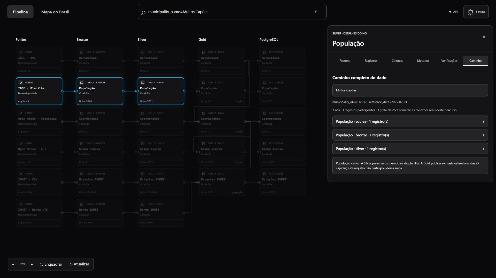
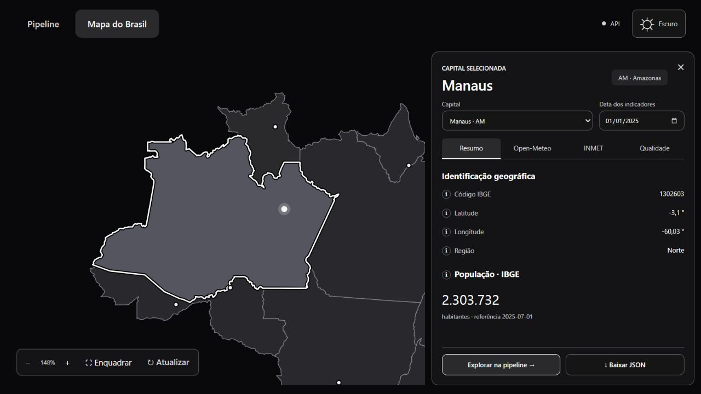
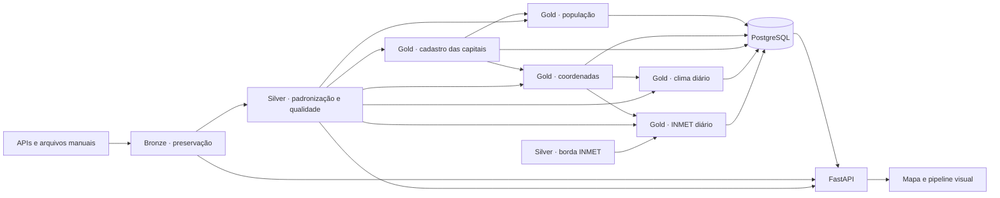

# Viajando com o Dado

**Da fonte pública à aplicação: engenharia de dados com rastreabilidade visual.**

[English version](README.en.md) · [Guia dos dados de entrada](data/README.md)

Uma aplicação para explorar informações demográficas e meteorológicas das capitais brasileiras e entender como cada registro foi coletado, preservado, tratado, relacionado e publicado.

O projeto reúne uma pipeline em PySpark, armazenamento intermediário em Parquet, publicação transacional no PostgreSQL, uma API em FastAPI e uma interface com mapa e grafo de transformações. A pesquisa acompanha registros por todas as etapas em que realmente participaram, inclusive quando não chegam à Gold.



## O que é possível explorar

- Consultar população, localização e indicadores meteorológicos das 27 capitais, incluindo Brasília.
- No mapa, a população usa a referência mais recente publicada para a capital; o seletor de data controla apenas os indicadores meteorológicos. Referências anteriores de população continuam consultáveis pela API.
- Comparar as informações disponíveis na Open-Meteo e no INMET, respeitando as diferenças entre as fontes.
- Examinar arquivos responsáveis, métodos descritos, colunas, verificações e registros de cada nó, sem entregar código-fonte à interface.
- Pesquisar municípios, estações ou valores de campos e visualizar o percurso completo, com junções e agregações destacadas.
- Entender por que um registro permanece em uma camada anterior. **Muitos Capões/RS**, por exemplo, aparece na planilha de população e na Silver, mas não é publicado pela Gold destinada às capitais.



## Dados e fontes

O recorte meteorológico padrão é **2025**. População é uma estimativa com data de referência própria, e não uma série diária nem um censo de 2025.

| Fonte | Obtenção e conteúdo | Papel no projeto |
| --- | --- | --- |
| [IBGE — Localidades](https://servicodados.ibge.gov.br/api/docs/localidades) | API de municípios; a coleta conserva as 27 capitais pelos IDs oficiais | Cadastro territorial: município, UF e região |
| [IBGE — Estimativas de população](https://www.ibge.gov.br/estatisticas/sociais/populacao/9103-estimativas-de-populacao.html) | Planilha `.xls` obtida manualmente | Estimativas municipais, referência e notas; todos os municípios da planilha permanecem na Silver |
| [Open-Meteo — Geocoding](https://open-meteo.com/en/docs/geocoding-api) | API de pesquisa por cidade e UF | Latitude e longitude utilizadas para consultar o clima |
| [Open-Meteo — Historical Weather](https://open-meteo.com/en/docs/historical-weather-api) | API histórica, com `models=era5` e `timezone=auto` | Temperaturas média/mínima/máxima, precipitação e vento máximo diários |
| [INMET — Dados históricos](https://portal.inmet.gov.br/dadoshistoricos) | CSVs de estações automáticas, obtidos manualmente | Medições horárias e metadados das estações; agregação diária na Gold |

**Open-Meteo e INMET têm naturezas diferentes.** A consulta ERA5 usa reanálise meteorológica; o INMET fornece observações de estações. Os valores não precisam coincidir e não são fundidos em uma única medição.

A planilha usada no desenvolvimento é `POP2025_20260828.xls`, com referência de população em **01/07/2025**. O nome identifica também uma revisão do arquivo; a data da revisão não altera automaticamente o ano de referência. O exemplo de Muitos Capões contém **2.937 habitantes nessa versão**.

Na configuração de 2025, cada tabela meteorológica da Gold possui um calendário de **27 × 365 = 9.855 linhas**. Isso não significa 9.855 medições válidas: dias sem dados ou sem estação elegível continuam representados com ausência explícita.

O mapa utiliza a **API de Malhas Geográficas do IBGE, versão 3**. O conteúdo do arquivo local `frontend/assets/brazil-states.geojson` foi conferido em **04/11/2026** e corresponde integralmente à resposta GeoJSON deste [endpoint oficial](https://servicodados.ibge.gov.br/api/v3/malhas/paises/BR?intrarregiao=UF&formato=application%2Fvnd.geo%2Bjson&qualidade=minima). São 27 feições: os 26 estados e o Distrito Federal.

Parâmetros utilizados: `intrarregiao=UF`, `formato=application/vnd.geo+json` e `qualidade=minima`. Sem `periodo` fixado, a consulta utiliza a versão vigente disponibilizada pela API. A comparação foi feita sobre o JSON, independentemente de espaços e quebras de linha. Consulte a [documentação oficial das malhas](https://servicodados.ibge.gov.br/api/docs/malhas?versao=3).

A malha fica incluída no frontend e é desenhada como SVG; abrir a aplicação não consulta o IBGE novamente. Os pontos das capitais e os indicadores vêm da Gold. Os contornos servem apenas como apoio visual, sem participar dos cálculos de qualidade ou da associação de estações.

### Como interpretar os indicadores do mapa

O seletor de data escolhe o **dia meteorológico**, no fuso local da capital. A população tem uma referência independente: selecionar **01/01/2025** e visualizar a estimativa de **01/07/2025** não transforma essa estimativa em uma contagem de habitantes de janeiro. O mapa apresenta as duas referências; não interpola uma população diária.

| Aspecto | Open-Meteo neste projeto | INMET neste projeto |
| --- | --- | --- |
| Natureza | Reanálise ERA5 em uma célula de grade próxima das coordenadas consultadas | Observações de uma estação automática associada à capital |
| Resolução recebida | Indicadores já agregados por dia | Medições horárias, agregadas pelo projeto no calendário local |
| Qualidade mostrada | Presença do registro, disponibilidade das cinco variáveis, ausências, valores inválidos e alertas | Associação da estação, horas válidas e cobertura específica por indicador |
| Significado de completude | As cinco variáveis diárias estão disponíveis e atendem às regras do projeto | A cobertura é calculada a partir das horas válidas; o requisito depende do indicador |
| Rajada | Não solicitada nesta coleta | Publicada quando há cobertura suficiente |

**“5 de 5 indicadores” não equivale a “24 de 24 horas”.** A resposta diária da Open-Meteo não permite comprovar cobertura horária de 100%. Da mesma forma, um indicador disponível e sem alertas não comprova exatidão absoluta da medição ou representatividade de todos os bairros.

Diferenças entre as fontes podem decorrer da grade de reanálise, do ponto e da altitude da estação e das formas de agregação. A aplicação mantém os valores separados. O contorno destacado no mapa representa a UF como contexto geográfico; os indicadores pertencem à capital e à fonte selecionadas, não a todo o estado.

### Exemplo de conferência dos valores

Nos arquivos utilizados na revisão da demonstração, São Paulo tem código IBGE **3550308** e população estimada de **11.904.961 habitantes**, com referência em **01/07/2025**. O valor consta também da [publicação oficial das estimativas de 2025 do IBGE](https://ftp.ibge.gov.br/Estimativas_de_Populacao/Estimativas_2025/POP2025_20251031.pdf).

| Fonte e dia em São Paulo | Média | Mínima | Máxima | Chuva | Vento máximo | Rajada máxima |
| --- | --- | --- | --- | --- | --- | --- |
| Open-Meteo · 01/01/2025 | 22,7 °C | 17,8 °C | 28,1 °C | 7,4 mm | 3,58 m/s | Não coletada |
| INMET · 17/01/2025 | 24,05 °C | 20,4 °C | 28,3 °C | 1 mm | 3,8 m/s | 8,5 m/s |

Essas linhas ilustram conferências independentes em **datas diferentes**; não constituem uma comparação entre fontes no mesmo dia. Na primeira, o JSON informa vento de **12,9 km/h**: dividir por **3,6** resulta em **3,5833… m/s**, arredondado para 3,58 m/s na interface. Na segunda, a média recalculada no CSV é **24,054166… °C**; a estação é **A701 · São Paulo – Mirante**, a aproximadamente **5,92 km** das coordenadas da capital usadas pelo projeto. Cada indicador desse dia tem 24 horas válidas.

Os exemplos documentam os arquivos conferidos, não uma garantia sobre futuras coletas ou publicações. Para repetir a conferência, selecione a mesma capital, data e fonte, confira unidades e qualidade e use as origens indicadas no percurso. Ao recalcular o INMET, respeite a distinção entre instante da mensagem e hora encerrada descrita abaixo.

## Arquitetura



A execução segue **ETL**: coleta e transformação nos arquivos das camadas, seguidas da publicação no banco. Os notebooks permitem estudar cada camada; o executor chama as funções Python diretamente, sem executar notebooks.

### Tratamentos por camada

| Camada | Responsabilidade |
| --- | --- |
| Coleta | Consulta IBGE, geocoding e clima; salva JSONs por UF. Uma falha de clima/geocoding preserva o par anterior daquela UF e registra a falha |
| Bronze | Preserva estrutura e valores da fonte; identifica origem. Na planilha, mantém aba, linha e células em JSON. No INMET, preserva cabeçalho, metadados e linha original |
| Silver | Padroniza tipos, nomes, IDs, coordenadas, datas e unidades; consolida duplicatas equivalentes e interrompe conflitos; separa ausência, valor inválido e alerta |
| Gold | Valida as capitais, relaciona as fontes, completa calendários e calcula indicadores diários com critérios explícitos de cobertura |
| Load | Confere contratos e chaves e publica as cinco tabelas e seus vínculos na mesma transação PostgreSQL; faz upsert por chave e preserva outros períodos já publicados |

As gravações Parquet usam uma saída temporária e conferência antes da substituição. Os mecanismos de recuperação de uma gravação interrompida permanecem ativos; eles não são um histórico de auditoria.

### Qualidade e regras do INMET

Na Silver, o INMET mantém precipitação, pressão atmosférica, radiação global, temperatura do ar, ponto de orvalho, umidade relativa, direção do vento, velocidade e rajada, incluindo extremos horários disponíveis na fonte. Valores como `-9999` são tratados como ausência; números não interpretáveis e incoerências físicas são identificados separadamente.

Na Gold, a associação de uma estação à capital é fixa para o período consultado e exige:

1. Mesma UF e distância de até **50 km** da capital.
2. Pelo menos **90% de cobertura de temperatura e precipitação** no período.
3. Entre as elegíveis, menor distância; empates consideram cobertura e código da estação.

| Indicador diário | Operação | Cobertura mínima |
| --- | --- | --- |
| Temperatura média | Média das temperaturas instantâneas válidas | 90% das horas esperadas |
| Temperatura mínima/máxima | Extremo das medições de intervalo | 100% |
| Precipitação | Soma dos acumulados horários | 100% |
| Vento máximo | Maior velocidade instantânea | 100% |
| Rajada máxima | Maior rajada dos intervalos | 100% |

Horários são interpretados em UTC e associados ao dia no fuso local. Medições instantâneas pertencem ao instante da mensagem; acumulados e extremos de intervalo pertencem à hora encerrada. As horas da borda completam o fim do ano local quando os metadados são compatíveis: mesma estação e UF e diferença cadastral de até 100 m.

**Sem estação elegível não significa que uma UF não possui estações.** Significa que nenhuma estação disponível satisfez os critérios adotados para aquela capital. O projeto não inventa medições para preencher essa ausência.

Temperaturas são apresentadas em °C, precipitação em mm e vento em m/s. O vento da Open-Meteo é convertido de km/h para m/s na Silver. A rajada exibida neste recorte vem do INMET; ela não faz parte dos campos solicitados à Open-Meteo.

### Onde cada verificação acontece

Na Open-Meteo, a **Silver** reconhece as unidades de entrada, expande as listas diárias, interpreta os valores e converte vento de km/h para m/s. A **Gold** recebe os valores padronizados, confere identidade e coerência da qualidade, rejeita datas duplicadas, relaciona o cadastro das capitais e completa o calendário. Apenas a variável inválida é anulada; os valores interpretáveis e os metadados de origem permanecem disponíveis na Silver.

A aba **Verificações** descreve regras cadastradas manualmente; não é um certificado de que cada regra foi executada para o registro escolhido. O resultado de execução aparece no Resumo, e a qualidade do dado deve ser consultada nos próprios campos. No catálogo atual, a lista Open-Meteo é compartilhada entre Silver e Gold: por isso, a frase “Unidades reconhecidas antes da conversão” pode aparecer na Gold, embora essa operação seja realizada na Silver. Esta explicação registra a diferença entre a descrição exibida e a implementação; a documentação não altera a interface.

## Como funciona o rastreamento

O projeto acompanha **uma execução atual**, com os valores nas camadas e vínculos leves de proveniência. Não mantém snapshots, versões de código nem histórico completo de alterações.

- `pipeline/shared/catalog.py` descreve manualmente nós, arquivos, métodos, verificações e dependências. Mudanças nas regras precisam ser refletidas nesse catálogo.
- `data/pipeline_status.json` informa estado, duração, contagens e falhas da execução atual.
- `pipeline_trace.current` identifica a publicação e o schema correspondente.
- `pipeline_trace.links` conserva chaves e relações de junção/agregação, sem duplicar os valores das tabelas.
- A Gold INMET gera `data/lineage/inmet_2025` com as horas efetivamente associadas a cada dia; o Load publica esses vínculos.
- O backend resolve relações simples pelas chaves e origens preservadas e calcula o percurso completo. Entradas de junções são incluídas sem expandir saídas alheias dessas dimensões.

O grafo destaca os nós participantes e **as conexões reais** do registro. Cada etapa mostra contagem e exemplos; os exemplos limitados não reduzem o percurso calculado. Os valores completos das camadas continuam disponíveis nas abas Registros.

O rastreamento exige uma publicação correspondente à execução concluída. Alterações comuns nos arquivos são detectadas por nome, tamanho e data de modificação; isso não é uma prova criptográfica contra adulteração. Fontes originais também são conferidas nas novas publicações. Percursos acima de 40 mil registros pedem um filtro mais específico em vez de serem apresentados como completos após truncamento.

### Como ler as contagens e os títulos do grafo

Os cartões mostram o **total do conjunto de dados naquela etapa**. O painel Caminho mostra apenas os **nós e registros participantes do percurso selecionado**. Assim, “13 nós · 13 registros participantes” pode coexistir com um cartão de 9.855 linhas: são escopos de contagem diferentes. Nós esmaecidos ficam fora daquele percurso, sem indicar necessariamente falha ou ausência de dados.

- **27 linhas na Bronze Open-Meteo → 9.855 na Silver:** cada linha Bronze preserva uma resposta anual de uma capital; a Silver expande as 365 datas. Esse aumento não representa, por si só, duplicação indevida.
- **População Bronze → Silver → Gold:** a Bronze conserva também linhas da planilha que precisam ser interpretadas; a Silver reúne os municípios extraídos; a Gold seleciona as capitais. Uma redução de linhas deve ser interpretada conforme essas operações, não como perda automática de dados.
- **“Estações INMET” na Gold/PostgreSQL:** apesar do título, cada registro publicado representa uma **capital e um dia**, com a estação escolhida, indicadores agregados e cobertura. Não é uma tabela com uma linha por estação.
- **Fonte → Bronze:** a prévia da fonte utiliza a leitura bruta da Bronze. Ver o mesmo conteúdo nos dois nós não representa uma nova medição independente; o arquivo original permanece identificado pela proveniência.

O percurso confirma quais registros e dependências foram associados à saída. Ele não prova, sozinho, que a fonte está correta nem que toda verificação descrita aprovou aquele registro.

## Executar tudo com Docker Compose

### Pré-requisitos

- Docker com motor Linux ativo e Docker Compose com suporte a `service_completed_successfully`.
- Dados manuais posicionados conforme [data/README.md](data/README.md).
- Aproximadamente **8 GB de memória disponíveis ao Docker**, espaço para imagens/dados e acesso à internet para a construção e a coleta. O Spark usa dois núcleos locais e driver de 4 GB.

Na raiz, copie o exemplo e preencha `PGPASSWORD` com uma senha local:

```powershell
if (-not (Test-Path .env)) { Copy-Item .env.example .env }
# Edite .env antes de continuar. Se ele já existir, preserve sua configuração.
docker compose up --build -d
```

Linux/macOS: use `cp .env.example .env` somente se ainda não houver configuração local.

Abra **http://127.0.0.1:8080**. Documentação da API: **http://127.0.0.1:8080/api/docs**. Os serviços de aplicação ficam disponíveis depois da primeira execução bem-sucedida da pipeline; a construção e o processamento podem demorar vários minutos.

O Compose usa o projeto isolado `viajando-com-o-dado-capitais` e inicia:

1. **postgres:** banco em volume nomeado, aguardado pelo healthcheck.
2. **pipeline:** na primeira inicialização, cria o banco da aplicação, processa as camadas e executa o Load. Quando já existe uma publicação, encerra sem reprocessar dados.
3. **backend:** inicia após a pipeline concluir, com acesso de leitura à pasta `data`.
4. **frontend:** Nginx com proxy `/api`; o navegador utiliza a mesma origem, sem depender do nome interno dos contêineres. O proxy acompanha mudanças de IP do backend pelo DNS interno do Docker, com revalidação em até cinco segundos.

O banco e o backend não expõem portas ao host. Apenas a interface fica ligada ao endereço local `127.0.0.1`. A criação do banco e a carga não apagam automaticamente um banco existente.

### Configuração e acompanhamento

| Variável | Uso |
| --- | --- |
| `PGUSER`, `PGPASSWORD`, `PGDATABASE` | Credenciais e banco da aplicação |
| `PIPELINE_YEAR` | Ano meteorológico; padrão 2025 |
| `PIPELINE_START_AT` | `consume` para consultar APIs; `bronze` para reutilizar os JSONs existentes |
| `VCD_GOLD_SCHEMA` | Schema das tabelas publicadas; padrão `gold` |
| `FRONTEND_PORT` | Porta local da interface; padrão 8080 |

Dentro do Compose, `PGHOST=postgres` e `PGPORT=5432` são definidos pela rede interna, independentemente da configuração para execução local.

```powershell
docker compose ps -a
docker compose logs -f pipeline
docker compose logs backend frontend
```

### Reiniciar o site sem reprocessar os dados

Quando já houver uma publicação, `docker compose up -d` e o ciclo `docker compose down` seguido de `docker compose up -d` **reutilizam os dados existentes**. Não consultam novamente as APIs nem executam Bronze, Silver, Gold ou Load. Alterar código, ano ou arquivos de entrada também não solicita reprocessamento automaticamente.

Para reiniciar somente a aplicação:

```powershell
docker compose restart backend frontend
```

### Reexecutar a pipeline manualmente

Somente execute os comandos abaixo quando quiser atualizar os dados. Eles substituem explicitamente o comando de inicialização; `docker compose run --rm pipeline` sozinho também reutiliza a publicação existente.

Coletar novamente pelas APIs e processar todas as camadas:

```powershell
docker compose run --rm pipeline python -m pipeline.run_pipeline --year 2025 --start-at consume --stop-after load
```

Reprocessar usando os JSONs já coletados:

```powershell
docker compose run --rm pipeline python -m pipeline.run_pipeline --year 2025 --start-at bronze --stop-after load
```

Para outro schema, acrescente `--schema NOME_DO_SCHEMA` com o mesmo valor de `VCD_GOLD_SCHEMA`.

Se apagar os JSONs coletados ou as camadas locais, manter o banco não recria esses arquivos. Execute o comando manual com `--start-at consume` para recompor os dados necessários ao rastreamento; reiniciar o site sozinho não faz essa recuperação.

Uma execução manual com erro permanece identificada como falha. Reiniciar o site não altera esse estado para sucesso e não tenta a pipeline novamente. Os dados já publicados continuam disponíveis no banco; o rastreamento bloqueia percursos inconsistentes até uma nova execução manual terminar. Se a primeira execução falhar antes de publicar, corrija a causa e execute novamente pelo comando manual.

Durante o processamento, o rastreamento aguarda a nova publicação consistente. Para encerrar os serviços preservando o volume do banco, use `docker compose down`. Não use `down -v` se pretende preservar esse banco.

Alterar a senha no `.env` não redefine a senha de um PostgreSQL já inicializado no volume. Preserve a senha configurada ou altere-a administrativamente no banco antes de atualizar a configuração.

## Executar sem Docker

Requisitos: **Python 3.12 ou superior**, Java 17 ou superior e PostgreSQL. O backend não inicia Spark; Java é necessário para a pipeline.

```powershell
python -m venv venv
.\venv\Scripts\Activate.ps1
python -m pip install -r requirements.txt
python -m pipeline.run_pipeline --year 2025
```

Para reaproveitar a coleta:

```powershell
python -m pipeline.run_pipeline --year 2025 --start-at bronze --stop-after load
```

Em terminais separados:

```powershell
python -m uvicorn backend.main:app --host 127.0.0.1 --port 8000
python -m http.server 5173 --bind 127.0.0.1 --directory frontend
```

A interface local fica em http://127.0.0.1:5173 e a documentação em http://127.0.0.1:8000/docs. Em Linux/macOS, ative o ambiente com `source venv/bin/activate`.

No Windows, o adaptador de filesystem utilizado pelo Spark permanece em `pipeline/bronze/lib`. A imagem Linux não depende dele. Os notebooks Bronze, Silver, Gold e Load podem ser usados separadamente para estudar cada etapa.

Use uma única pipeline por pasta de dados e mantenha o backend conectado ao banco publicado por essa execução. Não misture o banco local com o banco do Compose usando o mesmo estado de execução. O comando `--year` configura o recorte, mas não obtém automaticamente os arquivos manuais de outro ano.

## Pesquisas para experimentar

A busca é global: não exige selecionar previamente um nó. Havendo vários registros, escolha um resultado para calcular seu percurso completo. A consulta prioriza a camada mais avançada com correspondência em cada conjunto de dados, evitando listar a mesma linha repetidamente em todas as camadas.

| Pesquisa | O que observar |
| --- | --- |
| `municipality_name=Muitos Capões` | Planilha → Bronze → Silver; explicação de por que não chega à Gold |
| `population=2937` | Igualdade numérica; encontra a estimativa de Muitos Capões na versão utilizada |
| `Porto Velho` | Registros da capital em diferentes conjuntos de dados |
| `station_code=A925` | Registros da estação, conforme a cobertura disponível |
| `humidity_pct=41` | Medições de umidade na Silver INMET; não corresponde a 41,5 nem 141 |
| `recfe` | Correspondência aproximada para Recife |
| `municipality_name=Vitória` | Pesquisa de município sem exigir acentos |
| `Recife;17/03/2025` | Clima da capital nessa data |
| `Manaus; data=2025-12-31` | Selecione o resultado INMET para observar as horas da borda UTC |

Separe os filtros por **ponto e vírgula (`;`)**, como `Recife;17/03/2025` ou `municipality_name=São Paulo;date=2025-03-17`. Os espaços fazem parte dos nomes compostos; não são separadores de filtros.

Aliases: `population` → `population_estimate`; `humidity_pct` → `relative_humidity_percent`; `municipality_name` pesquisa nomes municipais. Datas aceitam `AAAA-MM-DD` e `DD/MM/AAAA`; códigos IBGE não são corrigidos silenciosamente. Use uma coluna de medição por consulta, combinável com município e data.

`month=2025-02-01` e `split=train` não produzem registros neste projeto: não há agregados mensais nem preparação de treino. A interface não inventa essas etapas para reproduzir exemplos de outro projeto.

## Estrutura

```text
.
├── compose.yaml               # Ordem e configuração dos quatro serviços
├── Dockerfile                 # Imagem Python/Java compartilhada
├── requirements.txt           # Dependências diretas e versões verificadas
├── data/                      # Fontes manuais/coletadas, camadas, estado e vínculos
├── pipeline/
│   ├── consume APIs/          # Clientes HTTP e coleta das capitais
│   ├── bronze/                # Preservação e leitura das fontes
│   ├── silver/                # Padronização e qualidade
│   ├── gold/                  # Junções, calendários e indicadores
│   ├── load/                  # Publicação PostgreSQL
│   ├── shared/                # Regras comuns, gravação, recuperação e vínculos
│   ├── EDAs/                  # Exploração em notebooks
│   └── run_pipeline.py        # Orquestração das funções
├── backend/
│   ├── core/                  # Configuração e conexões
│   ├── repositories/          # Consultas PostgreSQL e Parquet
│   ├── services/              # Busca e cálculo do percurso
│   ├── routes/                # Contrato HTTP
│   └── schemas/               # Validação e paginação
├── frontend/                  # HTML, CSS e JavaScript; mapa e grafo sem build
└── docs/images/               # Capturas reais da aplicação
```

O backend usa DuckDB em memória para consultar Parquets e psycopg para o PostgreSQL. SQL fica nos repositórios; rotas e serviços não reproduzem as transformações do Spark. Não há código de negócio no frontend.

## API e validação

| Endpoint GET | Finalidade |
| --- | --- |
| `/health` | Saúde do serviço |
| `/overview` | Resumo da publicação |
| `/datasets/{dataset}/records` | Dados publicados para o mapa |
| `/pipeline` | Nós, conexões e estado atual |
| `/pipeline/search?q=...` | Pesquisa entre camadas, com cursor de paginação |
| `/pipeline/journey?node_id=...&key=...` | Percurso completo de um registro |
| `/pipeline/nodes/{node_id}` | Métodos descritos, regras e schema do nó |
| `/pipeline/nodes/{node_id}/records` | Registros da etapa, paginados |

Os parâmetros `key` são objetos JSON com as chaves informadas no resultado da pesquisa. Caminhos de download ficam restritos às fontes cadastradas. A API não oferece endpoints para executar SQL, apagar dados ou iniciar a pipeline.

No desenvolvimento, a validação inclui testes de coleta, preservação de arquivos em falhas, recuperação, contratos INMET, qualidade, carga, busca e percursos com múltiplos pais. Os testes estão incluídos em `tests/` e `frontend/tests/`. Para executá-los:

```powershell
python -B -m unittest discover -s tests
node --test frontend/tests/*.test.mjs
docker compose config --quiet
```

Os testes de integração PostgreSQL exigem um banco exclusivo para testes; nunca aponte testes de carga ao banco da aplicação. As rotas e o mapa também permitem verificar o resultado publicado.

## Limites e decisões

- Projeto local de portfólio: autenticação, exposição pública e operação multiusuário não fazem parte do escopo atual.
- O caminho descreve a publicação atual, não um histórico de auditoria imutável.
- A escolha de estações usa proximidade e cobertura; não garante representatividade de microclimas urbanos.
- Dados manuais, disponibilidade das APIs e critérios de cobertura influenciam os resultados.
- A Gold é deliberadamente limitada às capitais; a Silver de população conserva municípios adicionais.
- Os dados pertencem às respectivas fontes. Consulte seus termos de uso e atribuição ao redistribuir arquivos ou resultados.

Referências técnicas: [ordem de inicialização do Compose](https://docs.docker.com/compose/how-tos/startup-order/) e [instalação do PySpark](https://spark.apache.org/docs/latest/api/python/getting_started/install.html).
